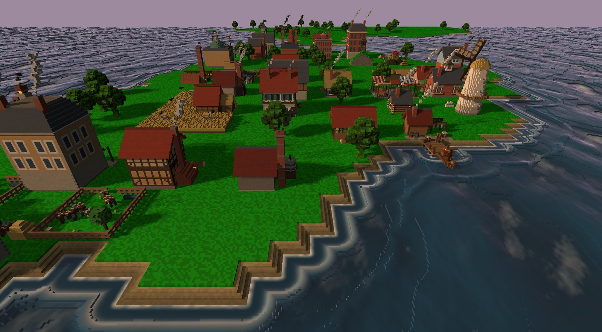
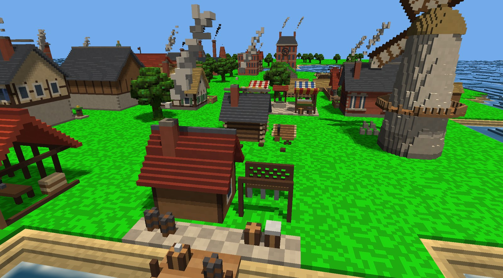
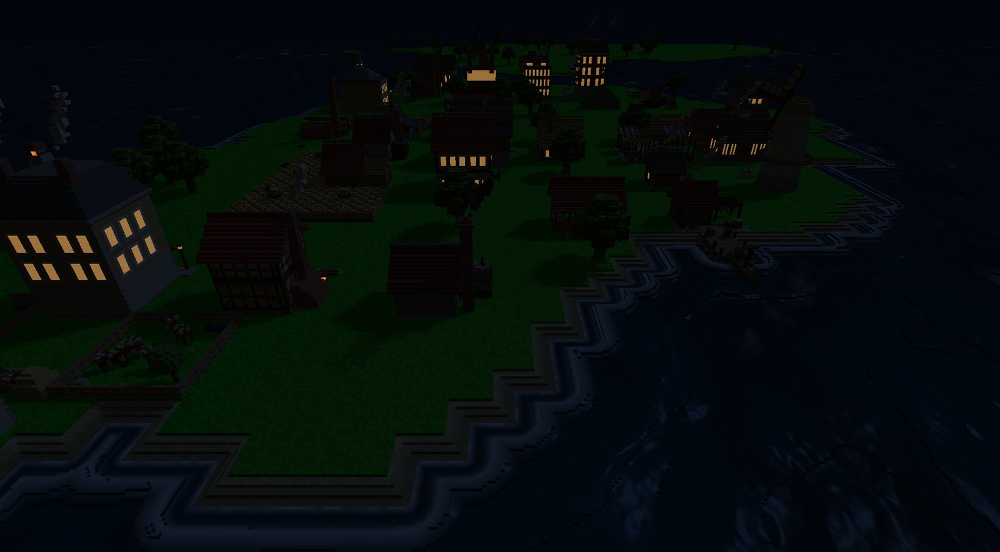
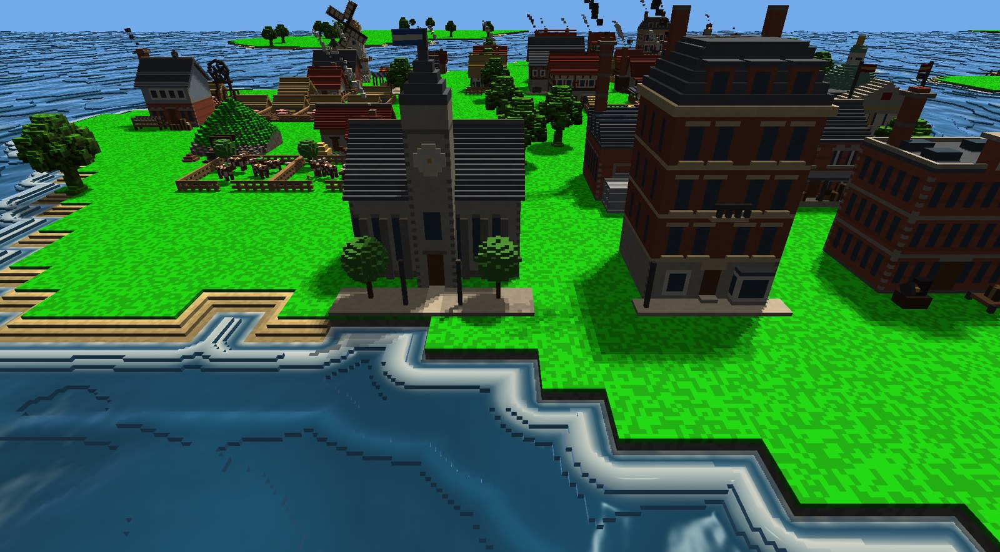
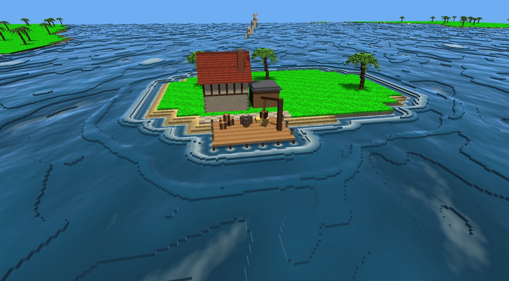
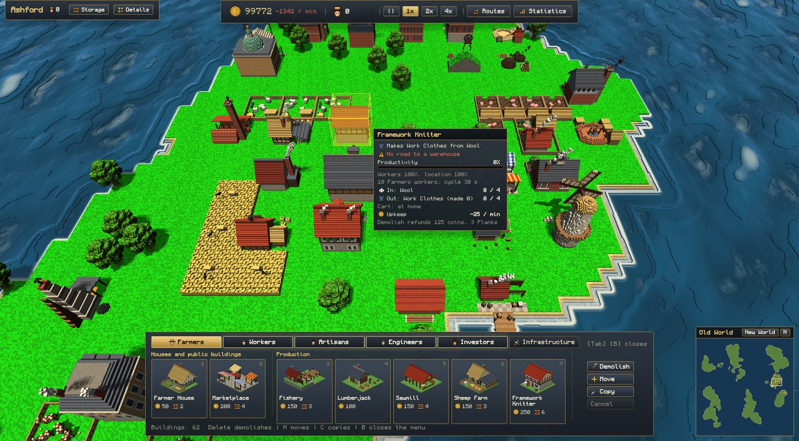

# Voxtaria

Voxtaria (voxel + Victoria) is a Victorian-era city-builder and trade game in the style of Anno 1800, built on a custom C++ voxel engine. Islands, buildings, people, carts and ships are all made of voxels and ray-marched on the GPU; the economy underneath runs on a fixed 10 Hz simulation.



| | |
|---|---|
|  |  |
| *The marketplace and a flour mill, smoke from the chimneys* | *Night: lit windows under the moon* |
|  |  |
| *The Engineers' quarter: the university and town houses* | *A trader's trading post in the New World* |


*The game UI: the construction menu, a building's card, the top bar and the minimap*

## Features

- **Voxel renderer:** no meshing; compute shaders ray-march chunked voxel data with sun and moon shadows, a day-night cycle, an FFT ocean, animated grass and chimney smoke. Moving things (walkers, carts, boats, ships) are voxel objects with their own models that float on the waves.
- **Islands:** islands in four sizes as in Anno 1800 (Small, Medium, Large and Extra large, from about 1500 to 9000 build tiles), each built from 12 x 12-voxel tiles with beaches, cliffs, caves and trees.
- **Building:** place, rotate, move (hold left click and drag) and demolish buildings on the tile grid. A green or red preview shows whether a spot is valid. Buildings are MagicaVoxel `.vox` models.
- **Roads and logistics:** drag L-shaped roads. Buildings need a road to a warehouse; producers' carts carry goods along the roads.
- **Population:** Farmers, Workers, Artisans, Engineers and Investors live in houses that grow, upgrade and shrink depending on how well their needs are met (goods, and services such as the marketplace, school, theatre, university and bank).
- **Production chains:** over thirty producers, from fisheries and sawmills to steelworks, glassworks and goldsmiths, with farm modules (pens and fields). Workforce, location rules (coast, trees, modules) and input buffers apply.
- **Economy:** coins from taxes minus building upkeep, build costs in coins and materials, game speed 0/1/2/4.
- **Ships and trade:** build ships at a harbor, sail them by right click, load and unload cargo, set up trade routes that ships sail on their own, and settle new islands. NPC traders buy and sell at their trading posts.
- **Two worlds:** fixed-size maps of the Old World and the tropical New World; ships cross between them.
- **Saving and loading:** any number of saves from the pause menu.
- **Sound:** sea, wind and the sounds of working buildings near the camera, and sounds for building, notifications and the UI.
- **Game UI:** Anno 1800-style dark slate panels with gold trim made with RmlUi, pixel lettering (Monocraft), a top ribbon with coins and the residents of each tier, and a picture of every building in the build menu.

## Controls

| Input | Action |
|---|---|
| WASD or arrow keys, screen edge | Pan the camera |
| Q / E | Rotate the camera |
| Mouse wheel | Zoom |
| B | Open or close the construction menu (hover a building for its card) |
| Tab, 1-9, 0 | Switch build menu tab, pick a building (it stays picked to place more) |
| R, Shift + mouse wheel | Rotate the building to place or move |
| Left click | Place, select a building or ship |
| Delete | Demolish tool: click or drag over buildings and roads |
| M | Move tool: click a building to pick it up, click again to set it down (or hold left click on it and drag) |
| C | Copy tool: click a building to build another like it |
| Right click | Cancel the tool or selection, close the building's panel; give a selected ship a move order |
| P or Space, + / - | Pause, change game speed |
| Esc | Put back a moved building, drop the tool or selection, close a window, or open the pause menu (settings, quit) |
| Minimap (bottom right) | Click to go there; N turns the camera north |
| F2 | Statistics: production and use of every good, population, finance |
| F3 | Debug overlay and minimap |
| F5 / F6 | Debug: chunk viewer, light visualizer |
| F1 | Free-fly debug camera (Tab frees the mouse) |

## Building

Requirements: CMake 3.24 or newer, a C++20 compiler (Visual Studio 2022 on Windows, GCC 11+ or Clang 14+ on Linux), git, and a GPU with OpenGL 4.4 and compute shaders. CMake downloads and builds every library itself: GLFW, GLM, Dear ImGui, RmlUi, FreeType and GoogleTest.

On Linux, install the compiler, CMake, and the X11 and OpenGL development packages first:

```sh
# Debian / Ubuntu
sudo apt install build-essential cmake git libx11-dev libxrandr-dev libxinerama-dev libxcursor-dev libxi-dev libgl-dev libfreetype-dev

# Arch
sudo pacman -S --needed base-devel cmake git libx11 libxrandr libxinerama libxcursor libxi mesa freetype2
```

Build, then run from the project root so the game finds `shaders/` and `assets/`:

```sh
cmake -B build -DCMAKE_BUILD_TYPE=Release
cmake --build build --config Release --parallel
./build/bin/Voxtaria                  # Linux
.\build\bin\Release\Voxtaria.exe      # Windows
```

The simulation tests are `VoxtariaTests`, next to the game (or `ctest --test-dir build -C Release`). Visual Studio can also open the folder directly.

Launch options: `--render-distance N`, `--render-scale F`, `--load FILE`, `--mute`, `--showcase` (every building placed, to look at them), `--no-vsync`, and for reproducible screenshots `--fixed-time T`, `--camera X Y Z YAW PITCH`, `--screenshot FILE SECONDS`.

## Project

- `CLAUDE.md` describes the architecture, the source layout and the coding rules.
- `docs/ROADMAP.md` holds the milestones; all of them (1-9, the UI milestone and the two worlds) are done. `docs/BALANCE.md` shows the economy's numbers.

## Credits

- **Libraries:** GLFW, GLM, Dear ImGui, RmlUi, miniaudio, FreeType, FastNoiseLite and glad; GoogleTest for the tests.
- **Font:** [Monocraft](https://github.com/IdreesInc/Monocraft) by Idrees Hassan (SIL Open Font License).
- **Sounds:** recordings in the public domain (CC0) from [BigSoundBank](https://bigsoundbank.com), listed in `assets/sounds/CREDITS.md`.
- Portions of this software are copyright © The FreeType Project (www.freetype.org). All rights reserved.

The licenses and notices of all of these are in `THIRD_PARTY_NOTICES.md`.

## License

GNU General Public License v3.0, see `LICENSE.txt`.
